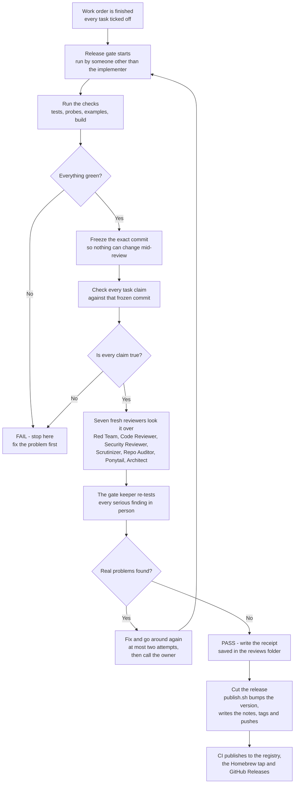

# gatekeeper

An adversarial release-verification skill for any repo that ships from work orders.
It sits between "all tasks ticked" and "pushed": a deterministic gate pass, task-truth
grading, a fleet of fresh-session reviewer subagents, a computed verdict, and a
receipt — then, and only then, the release cut and CI publishing.

> **Nobody grades their own exam.** The agent that implemented the work never runs the
> gate on it, and every reviewer runs in a fresh session that has never seen the
> implementer's reasoning.

Self-contained: the reviewer methods, the steps, and the scripts all ship inside this
folder. No external skill dependencies. MIT-credited adaptations are listed in
[resources/README.md](resources/README.md).

## Install

Copy this folder into your repo (or your agent's skills folder) as
`.agents/skills/gatekeeper/`. Then set it up — next section.

## Setup — the variable family

The skill adapts to your repo through one family of variables. You set each value in
**two places**: `SKILL.md` § Configuration (what the gate agent reads) and
`config.sh` (what the scripts source). `<set-me>` = required; empty = feature off.

| Variable | Meaning | Example |
|---|---|---|
| `REVIEW_FOLDER_PATH` | Where gate review receipts are written | `~/docs/reviews/` |
| `IMPLEMENTATION_SPEC_PATH` | Where specs and planning documentation live | `~/docs/specs/` |
| `WORK_ORDER_PATH` | Where work orders live or are created | `$IMPLEMENTATION_SPEC_PATH/<spec>/<work-order>/tasks.md` |
| `PACKAGE_NAME` | The package this skill releases | `my-app` |
| `CORE_PACKAGE_NAME` | Optional second package released in lockstep | `my-app-core` |
| `GATE_TEST_CMD` | The full test gate, run verbatim in Phase 0 | `pnpm test` / `npm ci && npm t` |
| `GATE_BUILD_CMD` | The build gate | `pnpm build` / `npm run build` |
| `GATE_PROBES_CMD` | Optional probe / deep-check gate | `pnpm test:probes` |
| `GATE_EXAMPLES_CMD` | Optional examples / docs gate | `vitest run examples/` |
| `RELEASE_CI_WORKFLOW` | Tag-triggered workflow under `.github/workflows/` | `release.yml` |
| `RELEASE_NOTES_CMD` | Optional custom notes generator | empty = bundled generator |
| `HOMEBREW_TAP_REPO` | Optional Homebrew tap as `owner/repo` | `me/homebrew-tap` |

**Humans:** fill `config.sh`, mirror the values into `SKILL.md` § Configuration, done.
**Agents:** hand your agent [AGENTS.md](AGENTS.md) — it walks the same setup, wires
CI, and sets reviewer switches.

Then do the one-time CI wiring in [FIRST_INSTALL.md](FIRST_INSTALL.md), read the
publishing practice in [PUBLISHING.md](PUBLISHING.md), and run your first gate.

## The flow

